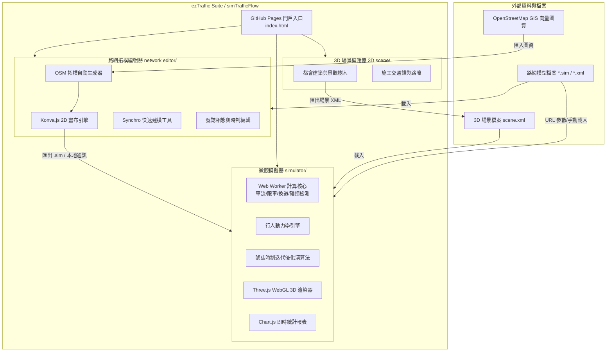

<div align="center">

# 🚦 ezTraffic

### 旗下旗艦產品：**simTrafficFlow**
**現代化網頁端微觀交通模擬與路網拓樸系統**  
*Next-Generation Web-Based Microscopic Traffic Simulation & Road Network Modeling Suite*

[](https://www.gnu.org/licenses/agpl-3.0)
[](https://eztraffic.github.io/simTrafficFlow/)
[](https://threejs.org/)
[](https://konvajs.org/)
[](https://www.openstreetmap.org/)
[-6366f1)](#-快速開始-quick-start)

[🚀 線上即刻體驗 (Live Demo)](https://eztraffic.github.io/simTrafficFlow/) •
[📖 核心模組介紹](#-三大核心系統模組) •
[🧩 經典範例庫](#-經典路網範例庫對照表) •
[🎥 教學與展示影片](#-影片展示與教學教程) •
[💻 本地端運行](#-快速開始-quick-start)

---

</div>

## 📌 關於專案 (About ezTraffic)

**ezTraffic** 致力於研發現代化、輕量、高相容性且無需繁複安裝設定的開源交通工程解決方案。  
其旗下核心旗艦產品 **simTrafficFlow** 為一套純前端（Pure Client-Side）的微觀交通流模擬與路網拓樸編輯系統。透過現代瀏覽器原生技術（HTML5 Canvas, WebGL/Three.js, Web Worker 多線程計算），提供交通工程師、都市規劃師、研究學者與學生一套功能全面且開箱即用的模擬生態系。

### ✨ 核心亮點 (Key Highlights)
- 🌐 **100% 純前端免安裝**：無需安裝任何龐大環境或編譯器，跨平台（Windows, macOS, Linux）隨開即用。
- 🛵 **真實混合車流模擬**：專為臺灣與亞洲高密度車流打造，精確模擬汽機車混流、機車車陣滲透、兩段式左轉待轉區及專用時相。
- 🚶 **微觀行人流動態**：支援行穿線、斜交對角全向行穿線（Scramble Crossing）、人車衝突禮讓與行人集結停等行為。
- 🗺️ **OpenStreetMap (OSM) 向量圖資秒級匯入**：直接選取地圖區域，一鍵自動建構真實路網幾何與節點車道拓樸。
- ⚡ **Synchro 快速建模模式**：視覺化多向轉向車道配置與相態分配，大幅縮減十字路口建模時間。
- 🚦 **智慧多時相號誌與 AI 迭代最佳化**：支援週期、綠信比、早開/遲閉時相配置，內建自動化號誌最佳化尋優演算法及交警手動介入模式。
- ⏱️ **數位孿生時鐘同步 (Digital Twin)**：支援與真實世界時間時鐘 1:1 等速運行，便於驗證真實尖峰時段管制策略。
- 🎮 **Three.js 3D 擬真渲染**：提供自由空拍視角、跟隨視角與第一人稱駕駛艙視角，搭配 Bloom 光影與環境貼圖。

---

## 🏗️ 系統架構圖 (System Architecture)



---

## 📦 三大核心系統模組

### 1. 🚦 微觀交通模擬器 (`simulator/`)
*路徑：[`simulator/main_01.html`](simulator/main_01.html)*

- **動力學核心**：採用獨立 Web Worker 多線程計算，確保千輛以上汽機車微觀動態運算時畫面維持 60 FPS 順暢度。
- **車輛行為**：智慧跟車間距計算、反應時間延遲、盲點換道機制、超車欲求、突發狀況急煞。
- **混合車流**：汽車、公車、機車、腳踏車異質混合流，機車前進穿梭與停等區群聚。
- **號誌最佳化**：可切換定時時制、感應時制，或啟動「迭代最佳化」由演算法自動計算降低路口總延滯之最佳綠燈時長。
- **即時圖表**：內建 Chart.js 儀表板，即時監控車流通過量（veh/hr）、平均車速、停等時間與排隊長度。
- **URL 參數自動載入**：支援 `?file=../example/xxx.sim` 參數，開啟網頁即刻自動載入路網開始模擬。

### 2. 🗺️ 路網拓樸編輯器 (`network editor/`)
*路徑：[`network editor/main.html`](network%20editor/main.html)*

- **向量化 CAD 畫布**：基於 Konva.js 向量圖形系統，提供平移、縮放、磁吸對齊與歷史復原/重做（Undo/Redo）。
- **OSM 地圖匯入**：結合 Leaflet 地圖，選取任一真實街區即可調用 Overpass API 自動生成對應車道數與交叉路口。
- **Synchro 快速建模模式**：提供快捷鍵 `Alt + S`，透過放射狀轉向箭頭點擊即可瞬間建立車道連接關係。
- **號誌相態設定**：視覺化設定各時相綠燈、黃燈、全紅清空時間，直覺建立保護左轉與早開時相。
- **工程標線與設施**：支援繪製槽化線、槽化島、斑馬線、車道箭頭、交通錐與點/線路段偵測器。
- **3D 模擬串接**：完成繪製後點擊「3D 模擬」按鈕，路網自動儲存並於新視窗啟動模擬器進行運作驗證。

### 3. 🏙️ 3D 場景地物編輯器 (`3D scene/`)
*路徑：[`3D scene/3D.html`](3D%20scene/3D.html)*

- **都會環境搭建**：支援多樣化高樓大廈、民居建築、行道樹木與照明路燈擺設。
- **施工與特殊路況**：自訂擺放施工圍籬、路障、交通錐，模擬車道局部封閉下之車流強制匯入。
- **XML 格式相容**：場景檔案可匯出為 XML 結構，並於模擬器中一鍵匯入整合。

---

## 🧩 經典路網範例庫對照表 (Example Gallery)

專案 `example/` 目錄內建豐富的臺灣與國際交通工程真實案例，可直接於線上門戶首頁一鍵體驗：

| 檔案名稱 (`.sim`) | 交通工程特徵與情境 | 關鍵要素 | 快速連結 |
| :--- | :--- | :--- | :--- |
| **`traffic_network_完整路口.sim`** | 標準四向大型十字路口旗艦範例 | 多車道、保護左轉、行穿線、多時相號誌 | [▶️ 3D 模擬](https://eztraffic.github.io/simTrafficFlow/simulator/main_01.html?file=../traffic_network_%E5%AE%8C%E6%95%B4%E8%B7%AF%E5%8F%A3.sim) |
| **`traffic_network_對角線行穿線.sim`** | 全向行人對角穿越道（Scramble Crossing） | 行人專用時相、全紅四向車輛清空、斜交人流 | [▶️ 3D 模擬](https://eztraffic.github.io/simTrafficFlow/simulator/main_01.html?file=../example/traffic_network_%E5%B0%8D%E8%A7%92%E7%B7%9A%E8%A1%8C%E7%A9%BF%E7%B7%9A.sim) |
| **`traffic_network_模擬行人穿越路口.sim`** | 行人穿越路口與人車衝突防禦性禮讓機制 | 行穿線碰撞預警、車輛停讓減速、綠燈未清空延滯 | [▶️ 3D 模擬](https://eztraffic.github.io/simTrafficFlow/simulator/main_01.html?file=../example/traffic_network_%E6%A8%A1%E6%93%AC%E8%A1%8C%E4%BA%BA%E7%A9%BF%E8%B6%8A%E8%B7%AF%E5%8F%A3.sim) |
| **`traffic_network_右轉槽化島.sim`** | 實體槽化島引導右轉車流提前減速分流 | 槽化島幾何、轉角半徑縮小、右轉續進優化 | [▶️ 3D 模擬](https://eztraffic.github.io/simTrafficFlow/simulator/main_01.html?file=../example/traffic_network_%E5%8F%B3%E8%BD%89%E6%A7%BD%E5%8C%96%E5%B3%B6.sim) |
| **`traffic_network_槽化線.sim`** | 車道標線導引與禁止跨越槽化區 | 車流匯流分流導引、視距維持 | [▶️ 3D 模擬](https://eztraffic.github.io/simTrafficFlow/simulator/main_01.html?file=../example/traffic_network_%E6%A7%BD%E5%8C%96%E7%B7%9A.sim) |
| **`traffic_network_模擬閃避交通錐.sim`** | 施工路段車道縮減與障礙物閃避 | 交通錐槽化擺設、強制換道動態、瓶頸消散 | [▶️ 3D 模擬](https://eztraffic.github.io/simTrafficFlow/simulator/main_01.html?file=../example/traffic_network_%E6%A8%A1%E6%93%AC%E9%96%83%E9%81%BF%E4%BA%A4%E9%80%9A%E9%8C%90.sim) |
| **`模擬停車.sim`** | 路側平行停車與倒車入庫對後方車流干擾 | 車道有效寬度驟減、突發回堵衝擊波 | [▶️ 3D 模擬](https://eztraffic.github.io/simTrafficFlow/simulator/main_01.html?file=../example/%E6%A8%A1%E6%93%AC%E5%81%9C%E8%BB%8A.sim) |
| **`traffic_network _時制計畫.sim`** | 號誌時序計畫與綠波續進測試 | 多週期時制變化、路網整體延滯評估 | [▶️ 3D 模擬](https://eztraffic.github.io/simTrafficFlow/simulator/main_01.html?file=../example/traffic_network%20_%E6%99%82%E5%88%B6%E8%A8%88%E7%95%AB.sim) |
| **`轉向路網.sim`** | 轉向比例分配與幾何多動向車流交會 | 轉向比矩陣、左右轉專用道配置 | [▶️ 3D 模擬](https://eztraffic.github.io/simTrafficFlow/simulator/main_01.html?file=../example/%E8%BD%89%E5%90%91%E8%B7%AF%E7%B6%B2.sim) |
| **`都市計畫與交通規劃.sim`** | 複合型路網規劃與周邊幹支道連接 | 多節點幹道系統、長距離車流分配 | [▶️ 3D 模擬](https://eztraffic.github.io/simTrafficFlow/simulator/main_01.html?file=../example/%E9%83%BD%E5%B8%82%E8%A8%88%E7%95%AB%E8%88%87%E4%BA%A4%E9%80%9A%E8%A6%8F%E5%8A%83.sim) |
| **`traffic_network_02.sim`** | 雙向多車道聯絡道路網走廊 (示範路網 02) | 10 組道路鏈結、連續車流前進與超車行為 | [▶️ 3D 模擬](https://eztraffic.github.io/simTrafficFlow/simulator/main_01.html?file=../example/traffic_network_02.sim) |
| **`traffic_network_03.sim`** | 連續號誌化路口與匝道匯流系統 (示範路網 03) | 12 組道路鏈結、連續號誌協調與匝道匯流 | [▶️ 3D 模擬](https://eztraffic.github.io/simTrafficFlow/simulator/main_01.html?file=../example/traffic_network_03.sim) |

---

## 🎥 影片展示與教學教程 (Video Tutorials)

點擊以下連結觀看詳細的 YouTube 影音操作指引：

- 📽️ **[simTrafficFlow 簡介短片 (中文)](https://youtu.be/BAZvrHUjW7s)**：平臺核心功能概覽、操作介面導覽與 3D 模擬展示。
- 📽️ **[Introduction Video (English)](https://youtu.be/CAMg6LhGEog)**：英文版平臺導覽與基本概念說明。
- 📽️ **[完整教學影片 (Full Tutorial)](https://youtu.be/ilt059AiuMo)**：從零開始建立路網幾何、繪製車道、配置號誌時制與匯入模擬之完整實作教學。
- 📽️ **[車流模擬演示 Video 1](https://www.youtube.com/watch?v=BGvrBOzjvz8)**：多向路口混合車流、機車待轉區與號誌轉換實況運作錄影。
- 📽️ **[車流模擬演示 Video 2](https://www.youtube.com/watch?v=1KJWYfGCAgs)**：施工路段閃避交通錐與車道縮減瓶頸情境展示。

---

## 💻 快速開始 (Quick Start)

### 方式一：線上直接使用 (推薦)
造訪官方 GitHub Pages 網站：  
👉 **[https://eztraffic.github.io/simTrafficFlow/](https://eztraffic.github.io/simTrafficFlow/)**  
無需安裝任何外掛，直接於網頁中點選核心模組或範例即可開始操作。

### 方式二：本地端伺服器運行
因瀏覽器本機檔案安全性限制（CORS 與 Web Worker 檔案讀取限制），需透過靜態 HTTP 伺服器啟動：

```bash
# 1. 複製專案庫
git clone https://github.com/eztraffic/simTrafficFlow.git
cd simTrafficFlow

# 2. 啟動本機伺服器 (選擇以下任一種方式)
# 使用 Python 3
python3 -m http.server 8080

# 或使用 Node.js npx serve
npx serve .

# 3. 開啟瀏覽器訪問
open http://localhost:8080
```

---

## 🚀 GitHub Pages 部署指南 (Deployment Guide)

本專案已配置全自動化 **GitHub Actions** 部署工作流（見 [`.github/workflows/deploy-pages.yml`](.github/workflows/deploy-pages.yml)）。

### 部署步驟：
1. **初始化 Git 倉庫並推送到 GitHub**：
   ```bash
   git init
   git add .
   git commit -m "feat: initialize simTrafficFlow suite and GitHub Pages portal"
   git branch -M main
   git remote add origin https://github.com/eztraffic/simTrafficFlow.git
   git push -u origin main
   ```
2. **在 GitHub 啟用 Pages 功能**：
   - 進入您的 GitHub 倉庫，點選 **Settings** -> **Pages**。
   - 在 **Build and deployment** 下方的 **Source** 選擇 **GitHub Actions**。
   - 系統將於每次 `main` 分支有新的提交時，自動構建並發佈至 `https://eztraffic.github.io/simTrafficFlow/`。

---

## 📂 專案目錄結構 (Directory Structure)

```text
simTrafficFlow/
├── index.html                   # 門戶入口網頁 (Landing Page - 淺色工程科技風)
├── README.md                    # 專案完整說明文件 (繁中 / 英文雙語導覽)
├── LICENSE                      # GNU AGPL-3.0 開源協議
├── .gitignore                   # Git 忽略檔案設定
├── .github/
│   └── workflows/
│       └── deploy-pages.yml     # GitHub Actions 自動部署工作流程
├── simulator/                   # 【微觀交通模擬器模組】
│   ├── main_01.html             # 模擬器主畫面 (3D WebGL / 2D Canvas)
│   ├── sim_engine_core.js       # 模擬核心運算
│   ├── sim_worker.js            # Web Worker 多線程車流計算核心
│   ├── script02.js              # 模擬控制器與 URL 參數自動載入
│   ├── script_pedestrian_sim.js # 行人微觀流動與行穿線引擎
│   ├── script_opt_iterator.js   # 號誌時制迭代最佳化演算法
│   ├── script_digital_twin.js   # 數位孿生真實時間時鐘同步
│   └── style01.css              # 模擬器介面樣式
├── network editor/              # 【路網拓樸幾何編輯器模組】
│   ├── main.html                # 向量編輯器主畫面
│   ├── editor.js                # Konva.js 繪圖邏輯與 Synchro 模式
│   ├── osm_importer.js          # OpenStreetMap 圖資匯入與圖層整合
│   ├── osm_network_builder.js   # OSM 向量道路幾何自動建構器
│   ├── subnetwork_tool.js       # 子路網拼接工具
│   └── style.css                # 編輯器樣式
├── 3D scene/                    # 【3D 場景地物編輯器模組】
│   └── 3D.html                  # 3D 場景地物建置主程式
├── example/                     # 【經典路網範例庫 (.sim XML)】
│   ├── traffic_network_對角線行穿線.sim
│   ├── traffic_network_模擬行人穿越路口.sim
│   ├── traffic_network_右轉槽化島.sim
│   ├── traffic_network_槽化線.sim
│   ├── traffic_network_模擬閃避交通錐.sim
│   ├── 模擬停車.sim
│   ├── traffic_network _時制計畫.sim
│   ├── 轉向路網.sim
│   ├── 都市計畫與交通規劃.sim
│   ├── traffic_network_02.sim
│   └── traffic_network_03.sim
└── traffic_network_完整路口.sim # 完整四向示範十字路口模型
```

---

## 📄 授權條款 (License)

本專案採用 **[GNU Affero General Public License v3.0 (AGPL-3.0)](LICENSE)** 授權開源。  
任何人皆可自由研讀、修改、衍生或分發本軟體，唯相關衍生工程與網路服務版本亦需維持 AGPL-3.0 開源授權，促進交通工程學術與技術社群的開放合作。

---

<div align="center">
<b>ezTraffic</b> • Empowering Open-Source Urban & Transportation Engineering Simulation.
</div>
